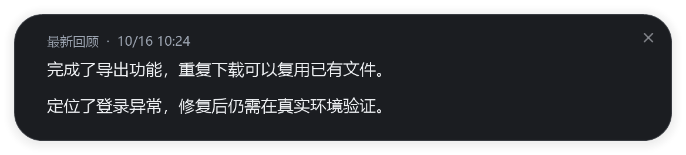

# Codex Work Recap · 工作回顾助手

把本机多个 Codex 会话中的工作进展，整理成几句准确、简短的回顾。在屏幕顶部以独立胶囊小窗显示，有值得看的新进展时再展开。

适合同时推进多个 Codex 聊天、想快速接回工作思路的 Windows 用户：

- 跨会话回顾最近在做什么、推进到哪里，也保留学习、分析和排查中的进展。
- 平时收在屏幕顶部，悬停查看已有回顾；查看本身不调用模型。
- 原会话只读，缓存保存在本机；生成摘要时使用已登录的 Codex 在线模型。

当前版本：**0.4.1**。由 Codex 插件入口、Python 后台和 Windows 原生小窗组成，不修改 Codex 安装包，不需要网页或监听端口。

这是社区维护的独立项目，与 OpenAI 无隶属关系，也不代表 OpenAI 官方支持。源码采用 [GPL-3.0-only](LICENSE) 许可。



*新版原生窗口渲染预览，内容为合成测试示例，不含真实聊天。*

## 使用条件

- Windows 桌面环境，Python 3.11 或以上；Python 代码只使用标准库。
- 已安装并登录 Codex，CLI 支持本项目使用的插件、`app-server` 和 `exec` 接口；不是任意旧版本 CLI 都能安装。
- 使用 **ChatGPT 登录** Codex，账号能够调用 `gpt-6.1-sol`。当前摘要固定使用该模型和 `medium` 推理。
- 网络连接和可用模型额度；模型在线运行，无需本地部署模型或独立显卡。

**当前不支持直接使用 API Key 登录。**摘要进程显式指定 `forced_login_method="chatgpt"`，并使用 `--ignore-user-config`，不会沿用自定义 API 服务。模型可用性取决于登录账号和 Codex 环境。

## 安装

使用 Git 获取源码，在 PowerShell 中执行：

```powershell
git clone https://github.com/lutonglin2020/codex-work-recap.git "$env:USERPROFILE\Codex_Work_Recap"
```

也可从仓库下载源码 ZIP，解压至同一路径，确保该目录下直接包含 `plugin.json` 和 `recap`。当前安装脚本要求源码位于用户主目录内；新电脑应重新生成 `dist`，不要复制另一台电脑的构建目录、缓存或登录文件。

安装插件并设置 Windows 登录自启：

```powershell
Set-Location "$env:USERPROFILE\Codex_Work_Recap"

$recapPython = py -3 -c "import sys; print(sys.executable)"
if ($LASTEXITCODE -ne 0) { throw "请先安装 Python 3.11 或以上及 Python 启动器" }
$recapCli = & $recapPython -X utf8 -c "from recap.adapter import discover_codex; print(discover_codex())"
if ($LASTEXITCODE -ne 0) { throw "未找到可用的 Codex CLI" }

& $recapPython -X utf8 scripts/install.py --codex $recapCli
if ($LASTEXITCODE -ne 0) { throw "插件安装失败，请检查上方错误" }

$recapInstall = Get-Content .\dist\install-result.json -Raw | ConvertFrom-Json
powershell -NoProfile -ExecutionPolicy Bypass -File .\scripts\startup.ps1 -Python $recapPython -PluginRoot $recapInstall.cache
if ($LASTEXITCODE -ne 0) { throw "登录自启配置失败" }

Set-Location $recapInstall.cache
& $recapPython -X utf8 -m recap --show
```

安装脚本通过 Codex 的 `codex plugin add` 注册插件，保留其他插件条目，并为当前解释器生成本地配置。自启脚本添加当前用户的 Windows 登录启动快捷方式。后台独立启动，小窗不依赖 Codex 是否在前台或最小化。

刚安装时没有摘要是正常状态。新聊天可加载插件工具；小窗本身不依赖聊天是否已加载这些工具。可选 hooks 需要在 Codex 中审阅并信任，未启用时仍可通过轮询工作。

安装后可用 `& $recapPython -X utf8 -m recap --status` 查看状态。CLI 接口、模型权限以及 Windows 的 DPI、多屏行为需要在目标设备确认；自动测试通过不代表全新电脑已经完成安装验收。

本次本机核对的 CLI 为 `0.162.0-alpha.17.2`。这不是最低版本保证；其他设备仍需确认接口与模型权限。

## 日常使用

- 平时保持顶部小条；悬停或点击查看缓存，不调用模型。鼠标移走约 2 秒收回。
- 自动回顾概括新的工作内容和进展，学习、分析、排查、方案讨论与实现交付都可更新，通常 1～2 句；成果可以优先，但不是门槛。重复内容、闲聊和泛泛建议保持安静。
- 按 `Asia/Shanghai` 计算日期：晨间 06:00～12:00 的每日首次自动评估回顾昨天，其余自动评估关注最近 60 分钟。
- 系统先检查新增材料，再由模型判断是否值得更新内容。内容更新后，小窗按空闲、全屏和冷却另行决定展开时机；专注状态不会成为拒绝更新内容的理由。20～60 分钟是模型建议的再评估间隔，不是定时必弹。
- 右键可暂停、恢复或退出小窗。没有新内容、正在更新或更新失败时，默认保留上一条有效回顾，重启后仍可查看；有新摘要时再替换。旧回顾不会再次自动弹出，只有从未生成有效回顾时才显示简短状态提示。

在已安装插件目录中可执行：

```powershell
python -m recap --status   # 查看状态
python -m recap --show     # 展开缓存，不调用模型
python -m recap --refresh  # 主动刷新，可能调用模型
python -m recap --stop     # 停止后台和小窗
```

## 数据与隐私

只读取当前用户本机已保存的 Codex 主会话，提取用户请求和最终答复；不写原会话或项目文件。需要总结时，筛选后的内容会交给 Codex 在线模型处理，因此不要把“本地缓存”理解为“离线推理”。

本项目的数据位于 `$env:USERPROFILE\.codex\work-recap-data`，也可通过 `WORK_RECAP_DATA` 覆盖。SQLite 来源缓存保留最近 14 天、最多 600 条裁剪记录，另保留最多 48 份摘要和 128 个事件。不要上传这个目录、`dist` 或认证文件；本地摘要也可能包含工作信息。

不覆盖其他电脑或云端聊天，不同步历史。采集有分页和输入长度上限；近期工作重心优先取材，不保证每个会话都出现在回顾中。Codex 接口和模型权限变化可能需要适配，其他电脑的实际兼容性应在安装后检查。

## 停用

保留源码目录中的 `dist/install-result.json`，可用其中的实际安装信息移除自启与插件：

```powershell
Set-Location "$env:USERPROFILE\Codex_Work_Recap"
$recapInstall = Get-Content .\dist\install-result.json -Raw | ConvertFrom-Json
$recapCli = & $recapInstall.interpreter -X utf8 -c "from recap.adapter import discover_codex; print(discover_codex())"
if ($LASTEXITCODE -ne 0) { throw "未找到可用的 Codex CLI" }
& $recapInstall.interpreter -X utf8 -m recap --stop
powershell -NoProfile -ExecutionPolicy Bypass -File .\scripts\startup.ps1 -Python $recapInstall.interpreter -PluginRoot $recapInstall.cache -Remove
& $recapCli plugin remove "$($recapInstall.plugin)@$($recapInstall.marketplace)"
```

移除自启或插件不会删除历史数据。需要清除回顾历史时，停止后台后再自行处理上文的数据目录。

## 开发与反馈

开发验证：`python -m unittest discover -s tests -v`。默认测试不调用真实模型；原生窗口或真实模型检查需单独启用。

欢迎通过 [Issues](https://github.com/lutonglin2020/codex-work-recap/issues) 报告可复现的问题或提出改进建议，也欢迎提交 Pull Request。请附 Windows、Python、Codex CLI 版本和复现步骤，先去除日志中的真实工作内容、路径和认证信息。提交说明见 [CONTRIBUTING.md](CONTRIBUTING.md)。

实现说明：[后台契约](docs/backend-contract.md)、[原生小窗](docs/widget.md)、[界面原则](docs/ui-design.md)。

## 许可证

Copyright (C) 2026 lutonglin2020。

本项目按 GNU General Public License 第 3 版（仅此版本，`GPL-3.0-only`）发布，完整条款见 [LICENSE](LICENSE)。软件按现状提供，不附带保证。项目名称中提及 Codex 仅用于说明兼容对象。
